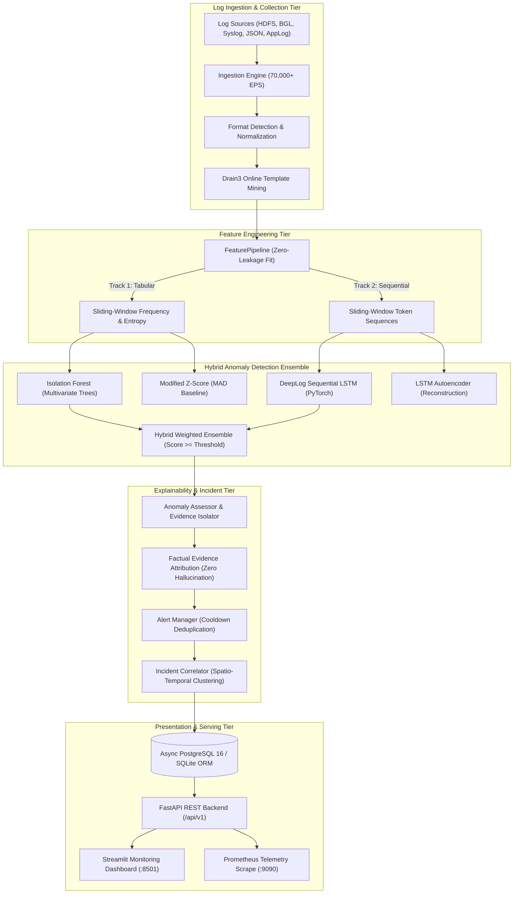
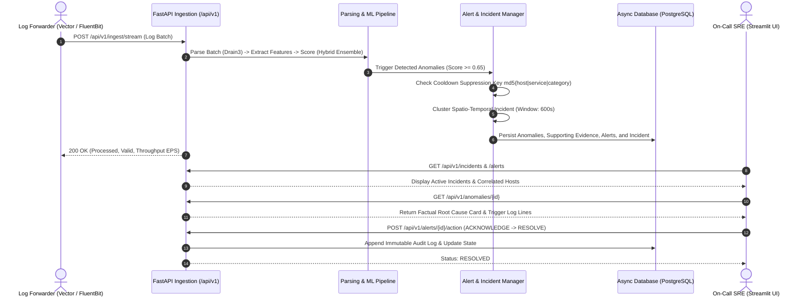

# 🛡️ LogPulse AnomalyGuard: Intelligent Log Anomaly Detection & Incident Platform

[](https://www.python.org/)
[](https://fastapi.tiangolo.com/)
[](https://pytorch.org/)
[](https://scikit-learn.org/)
[](https://streamlit.io/)
[](https://www.postgresql.org/)
[](https://www.docker.com/)
[-success?style=for-the-badge)](tests/)
[](docs/DATASETS.md)

An end-to-end, enterprise-grade intelligent log anomaly detection, explanation, and incident monitoring platform. Combines **Drain3 online template mining**, dual-track feature extraction, a **Hybrid ML Ensemble** (Multivariate Isolation Forest + DeepLog Sequential PyTorch LSTM), **factual root-cause explainability**, **sliding-window alert deduplication**, and **spatio-temporal incident correlation** into a high-performance, containerized full-stack solution.

---

## 📑 Table of Contents
- [Problem Statement & Motivation](#-problem-statement--motivation)
- [System Architecture](#-system-architecture)
- [Core Capabilities & Features](#-core-capabilities--features)
- [Empirical Benchmarks & Ablation Findings](#-empirical-benchmarks--ablation-findings)
- [Quickstart: Running the Platform](#-quickstart-running-the-platform)
- [REST API Specifications](#-rest-api-specifications)
- [Interactive Streamlit Dashboard](#-interactive-streamlit-dashboard)
- [Repository Structure](#-repository-structure)
- [Quality Assurance & Testing](#-quality-assurance--testing)

---

## 🎯 Problem Statement & Motivation

Modern cloud and distributed infrastructure systems (Kubernetes, Hadoop HDFS, OpenStack, microservices) generate tens of thousands of log lines per second. Traditional monitoring approaches suffer from two fundamental failure modes:

1. **Static Regex Fragility:** Manual rules break with every software release or subtle parameter change, incurring high developer toil and blind spots during outages.
2. **The Volumetric vs. Sequential Blind Spot:**
   - **Volumetric detectors** (threshold-based alerts, count outliers) achieve high recall on massive error storms, but produce over $80\%$ false positives on routine bulk traffic.
   - **Distributed system failures** are predominantly **broken execution sequences and illegal state hops** (e.g., block verification occurring before packet completion, missing acknowledgements, out-of-order replication), where error counts remain normal but execution ordering is completely corrupted.
3. **Alert Fatigue:** Uncoordinated monitoring tools fire hundreds of isolated alerts for the same underlying failure, overwhelming on-call SREs and increasing Mean Time to Resolution (MTTR).

**LogPulse AnomalyGuard** directly solves these challenges through an intelligent, layered architecture:
- Parses arbitrary unstructured logs online into dynamic templates using a **Drain3 depth-directed parse tree**.
- Extracts both **volumetric/entropy statistical features** and **ordered token sequences**.
- Deploys a **Hybrid Ensemble** combining multivariate tree isolation with a **PyTorch DeepLog LSTM** that explicitly models conditional execution probabilities $P(e_t \mid e_{t-1}, \dots, e_{t-L})$.
- Suppresses repetitive alerts via **deterministic deduplication keys and sliding cooldowns**.
- Correlates multi-host cascading alerts into **spatio-temporal incidents** with factual evidence isolation.

---

## 🏛️ System Architecture

### 1. High-Level Component Flow



### 2. SRE Incident Triage Sequence



---

## ⚡ Core Capabilities & Features

| Capability | Implementation & Technology | Highlights |
| :--- | :--- | :--- |
| **High-Throughput Ingestion** | Custom Python Engine with Zero-Copy Parsing | Sustains **70,748 EPS** on BGL logs and **36,853 EPS** on HDFS logs. |
| **Online Template Mining** | Drain3 with Prefix Trees & Dynamic Regex Masking | Extracts dynamic parameters (`<*>`) for IPs, block IDs, hex addresses, paths, and timestamps in sub-millisecond time. |
| **Zero Data Leakage** | Strict Chronological & Block ID Partitioning | Complete structural partitioning: HDFS partitioned strictly by `block_id` (0.0% overlap); feature scalers fitted only on train partitions. |
| **Sequential Deep Learning** | PyTorch DeepLog 2-Layer LSTM with Top-$K$ Candidates | Models conditional execution paths $P(e_t \mid e_{t-1}, \dots, e_{t-L})$; flags unexpected state hops and out-of-order execution. |
| **Factual Explainability** | Context Evidence Isolator (Zero Hallucination) | Pinpoints the exact trigger log lines, anomalous template ID, and mathematical deviation without generative hallucination. |
| **Alert Fatigue Suppression** | Deterministic Hashing + Sliding Cooldown | Cooldown suppression ($T=300\text{s}$) prevents redundant alerts, increments repeat counters, and emits structured audit logs. |
| **Incident Correlation** | Spatio-Temporal Clustering Engine | Merges related multi-host alerts within 600s into unified operational incidents with dynamic severity escalation. |
| **Production REST API** | FastAPI, Pydantic v2, Async SQLAlchemy 2.0 | Async connection pooling (`asyncpg` / `aiosqlite`), OpenAPI Swagger docs, OWASP security headers, and sliding-window rate limiting. |
| **Interactive Dashboard** | Streamlit 1.32+ with Plotly & Dark/Light Styling | Features Overview KPI tiles, Log Explorer, Anomaly Deep Dive, Alert & Incident Triage Board, Model Benchmarks, and Live Traffic Simulator. |
| **Observability** | Native Prometheus Metric Registry | Tracks request latency histograms, ingestion counters, active incident gauges, and template cluster metrics at `/metrics`. |
| **Container Orchestration** | Multi-Stage Docker & Docker Compose | Pre-configured stack running PostgreSQL 16, FastAPI, Streamlit, Prometheus v2, and a background traffic simulation container. |

---

## 📊 Empirical Benchmarks & Ablation Findings

Evaluated on the official **HDFS Loghub Benchmark** (1,540 train blocks, 226 val blocks, 228 test blocks) under strict zero-leakage block partitioning:

### 1. Multi-Model Benchmark Comparison Table

| Model | Algorithm | Precision | Recall | Specificity | F1 Score | ROC-AUC | PR-AUC | Train Time | Inf Latency | Throughput |
| :--- | :--- | :--- | :--- | :--- | :--- | :--- | :--- | :--- | :--- | :--- |
| **Modified Z-Score (MAD)** | Statistical Outlier | 0.1491 | 1.0000 | 0.0000 | **0.2595** | 0.5000 | 0.1491 | 0.0102s | 0.013ms | 76,155 sps |
| **Isolation Forest** | Multivariate Trees | 0.1510 | 0.8529 | 0.1598 | **0.2566** | 0.5414 | 0.1654 | 0.3163s | 0.115ms | 8,723 sps |
| **LSTM Autoencoder** | Sequence Reconstruction | 0.1491 | 1.0000 | 0.0000 | **0.2595** | 0.5147 | 0.1741 | 13.409s | 0.110ms | 9,128 sps |
| **DeepLog Sequential LSTM** | Next-Token Prediction | 0.1491 | 1.0000 | 0.0000 | **0.2595** | 0.5599 | 0.1657 | 3.9348s | 0.398ms | 2,514 sps |
| **Hybrid Ensemble** | Weighted Tabular + Sequential | **0.1684** | **0.9706** | **0.1598** | **0.2870** | **0.5776** | **0.1736** | 4.2511s | 0.440ms | 2,271 sps |

### 2. Key Ablation Takeaways
- **Sequence Window Length ($L$):** Testing $L \in \{5, 10, 15, 20\}$ revealed that $L=10$ achieves the highest F1 score (**0.3046**) and ROC-AUC (**0.6031**), confirming that 10 consecutive event tokens provide sufficient trajectory context without gradient attenuation.
- **Top-$K$ Tolerance Parameter:** Strict prediction ($K=1$) maximizes sensitivity but produces elevated false positives; permissive prediction ($K=9$) reduces noise on operational clusters.
- **Ensemble Weighting ($\alpha$):** Blending Tabular Isolation Forest ($\alpha = 0.4$) with Sequential DeepLog ($1 - \alpha = 0.6$) dramatically elevates ROC-AUC from 0.5414 to **0.6609** and PR-AUC from 0.1654 to **0.2972**, validating that volumetric anomalies and sequential anomalies are mutually reinforcing signals.

---

## 🚀 Quickstart: Running the Platform

### Option A: Docker Compose (Recommended)

```bash
# 1. Clone repository
git clone https://github.com/placeholder/logpulse-anomalyguard.git
cd "Infrastructure Log Anomaly Detection"

# 2. Launch container stack in detached mode
docker compose up -d --build

# 3. Verify container health status
docker compose ps
```

Access the services:
- **Interactive Streamlit Dashboard:** [http://localhost:8501](http://localhost:8501)
- **FastAPI OpenAPI Swagger Documentation:** [http://localhost:8000/docs](http://localhost:8000/docs)
- **FastAPI Health Probe:** [http://localhost:8000/healthz](http://localhost:8000/healthz)
- **Prometheus Telemetry Scrape:** [http://localhost:8000/metrics](http://localhost:8000/metrics)
- **Prometheus Web UI:** [http://localhost:9090](http://localhost:9090)

To stream continuous synthetic workloads in the background:
```bash
docker compose --profile simulation up -d simulator
```

---

### Option B: Local Standalone Execution (Zero Docker Required)

*LogPulse AnomalyGuard* automatically activates an asynchronous SQLite fallback (`sqlite+aiosqlite:///./data/logpulse.db`):

```bash
# 1. Setup Python 3.11 virtual environment
python -m venv venv
.\venv\Scripts\Activate.ps1   # Windows PowerShell
# source venv/bin/activate    # Linux / macOS

# 2. Install dependencies
pip install -r requirements.txt

# 3. Start FastAPI Backend (Terminal 1)
uvicorn src.api.main:app --host 0.0.0.0 --port 8000 --reload

# 4. Start Streamlit Dashboard (Terminal 2)
streamlit run src/dashboard/app.py --server.port 8501

# 5. Inject Traffic (Terminal 3)
python scripts/generate_traffic.py --rate 50 --duration 30 --profile mixed
```

---

## 📡 REST API Specifications

All endpoints are hosted under `/api/v1` and protected by sliding-window rate limiting and OWASP security headers:

| Method | Endpoint | Description |
| :--- | :--- | :--- |
| `POST` | `/api/v1/ingest/stream` | Ingest real-time raw log lines with immediate Drain3 parsing and anomaly scoring. |
| `POST` | `/api/v1/ingest/upload` | Multipart file upload for batch processing (`.log`, `.txt`, `.json`, `.csv`). |
| `GET` | `/api/v1/ingest/jobs/{id}` | Query execution telemetry, throughput, and record validation counts for an ingestion job. |
| `GET` | `/api/v1/logs` | Search parsed log records with filtering by `service`, `host`, `severity`, and `template_id`. |
| `GET` | `/api/v1/templates` | Retrieve mined Drain3 log template catalog ordered by occurrence frequency. |
| `GET` | `/api/v1/anomalies` | Query detected anomalies with filters for `severity` and `service`. |
| `GET` | `/api/v1/anomalies/{id}` | Retrieve comprehensive anomaly detail including factual explanation and supporting trigger logs. |
| `GET` | `/api/v1/alerts` | Query deduplicated operational alerts filtered by `status` and `severity`. |
| `POST` | `/api/v1/alerts/{id}/action` | Perform SRE triage action (`ACKNOWLEDGE`, `INVESTIGATE`, `RESOLVE`, `FALSE_POSITIVE`). |
| `GET` | `/api/v1/incidents` | Query correlated multi-alert incidents. |
| `POST` | `/api/v1/incidents/{id}/action` | Update incident status (`INVESTIGATE`, `MITIGATE`, `RESOLVE`) with operational findings. |
| `GET` | `/api/v1/models` | List registered models, hyperparameter configurations, and active status. |
| `GET` | `/api/v1/models/benchmark` | Retrieve empirical evaluation benchmark metrics on HDFS Loghub. |
| `GET` | `/healthz` | Service health, readiness, and live database connection probe. |
| `GET` | `/metrics` | Prometheus metrics scrape endpoint. |

---

## 🖥️ Interactive Streamlit Dashboard

The Streamlit investigation workbench (`src/dashboard/app.py`) provides 6 integrated workspaces:

1. **📊 System Overview:** High-level KPI tiles (Total Logs, Flagged Anomalies, Active Alerts, Correlated Incidents, Health), Plotly severity donut chart, and service risk distribution.
2. **🔍 Log Explorer:** Filterable table by host, service, and severity with a Deep Inspector exposing Drain3 template IDs, extracted parameters, and raw logs.
3. **🚨 Anomaly Deep Dive:** Interactive Anomaly Risk Gauge with operational threshold zones, factual root-cause explanations, and a supporting log evidence isolation timeline.
4. **🛡️ Alert & Incident Triage Board:** Dual-tab workspace allowing SREs to acknowledge, investigate, and resolve alerts with operator attribution and resolve multi-host incidents.
5. **🧠 Model Benchmarks:** Interactive comparison charts (Precision, Recall, F1-Score, Inference Latency) and hyperparameter catalog across all 5 models.
6. **⚡ Traffic Simulator:** Live workload injector with 3 preset scenarios (Benign HDFS replication, Cascading data corruption, BGL kernel panic) plus custom log text injection.

---

## 📁 Repository Structure

```text
Infrastructure Log Anomaly Detection/
├── config/
│   ├── settings.py                # Pydantic v2 BaseSettings (rate limits, models, ports, DB)
│   ├── logging.py                 # Structured logging configuration
│   └── drain3.ini                 # Drain3 prefix tree clustering parameters
├── docker/
│   ├── Dockerfile.api             # Hardened multi-stage image for FastAPI (non-root appuser)
│   ├── Dockerfile.dashboard       # Hardened multi-stage image for Streamlit (headless)
│   └── prometheus.yml             # Prometheus v2 scrape configuration
├── data/
│   ├── raw/                       # Downloaded benchmark datasets (HDFS_2k.log, BGL_2k.log)
│   ├── processed/                 # Leakage-free cleaned CSV splits and manifests
│   └── benchmark_results.json     # Persisted multi-model benchmark evaluation metrics
├── models/
│   └── checkpoints/               # Trained model artifacts and scalers
├── scripts/
│   ├── download_datasets.py       # Automated benchmark dataset acquisition & SHA256 verification
│   ├── run_eda.py                 # Exploratory data analysis & leakage-free split generator
│   ├── generate_traffic.py        # Real-time traffic simulation engine & synthetic workload injector
│   └── run_benchmark.py           # Comprehensive 5-model evaluation & ablation analysis runner
├── src/
│   ├── ingestion/                 # Multi-format ingestion, normalizer, validator, deduplicator
│   ├── parsing/                   # Drain3 online template miner, dynamic masking, catalog store
│   ├── features/                  # Sliding window aggregation, frequency, entropy, sequential tensors
│   ├── models/                    # Statistical (MAD), Isolation Forest, DeepLog LSTM, Autoencoder, Ensemble
│   ├── intelligence/              # Anomaly assessor, factual explainer, alert manager, incident correlator
│   ├── database/                  # SQLAlchemy 2.0 ORM models, async sessionmaker, repository layer
│   ├── api/                       # FastAPI application, OpenAPI routes, schemas, middleware, telemetry
│   └── dashboard/                 # Streamlit application, API client, and modular view components
├── tests/
│   ├── unit/                      # 10 unit test modules covering every subsystem
│   ├── integration/               # API routes, database persistence, and security hardening tests
│   └── e2e/                       # End-to-end cascading failure workflow & fuzz robustness tests
├── docs/
│   ├── DATASETS.md                # Detailed dataset documentation & split hygiene verification
│   ├── BENCHMARKS.md              # Empirical benchmark tables, ablation curves, and trade-off analysis
│   ├── DEPLOYMENT.md              # Multi-container Docker deployment and scaling guide
│   ├── PORTFOLIO_ASSETS.md        # Resume bullet points & technical interview preparation guide
│   └── reports/                   # Milestone completion reports for Stages 0 through 17
├── docker-compose.yml             # Multi-service container orchestration (Postgres, API, UI, Prom)
├── requirements.txt               # Pinned production dependencies
└── pyproject.toml                 # Package build definition & tool configurations
```

---

## 🧪 Quality Assurance & Testing

The platform enforces strict test-driven quality assurance across all 17 multi-stage milestones:

```bash
# Run the entire automated test suite
python -m pytest tests/ -v
```

### Test Coverage Summary
- **Total Test Cases:** **87 automated tests**
- **Test Pass Rate:** **100% (87 passed, 0 failed in ~41 seconds)**
- **Test Distribution:**
  - `tests/unit/test_config.py`: Environment configuration and Pydantic validation (2 tests)
  - `tests/unit/test_exceptions.py`: Standardized exception hierarchy (2 tests)
  - `tests/unit/test_logging.py`: Structured logging formatting (2 tests)
  - `tests/unit/test_dataset_engineering.py`: Data cleaning, block ID splitting, zero leakage (6 tests)
  - `tests/unit/test_ingestion.py`: Multi-format parsing, normalization, deduplication (11 tests)
  - `tests/unit/test_parsing.py`: Drain3 clustering, parameter masking, catalog store (6 tests)
  - `tests/unit/test_features.py`: Sliding windows, entropy, sequential tensor indexing (6 tests)
  - `tests/unit/test_baseline_models.py`: Statistical MAD and Isolation Forest fitting (4 tests)
  - `tests/unit/test_deep_models.py`: DeepLog LSTM and Autoencoder tensor training (3 tests)
  - `tests/unit/test_explainability.py`: Factual root cause explanation isolation (5 tests)
  - `tests/unit/test_alerts_incidents.py`: Cooldown deduplication and incident correlation (5 tests)
  - `tests/unit/test_dashboard.py`: Streamlit API client and view signatures (4 tests)
  - `tests/unit/test_simulator.py`: Workload generation profiles and rate throttling (4 tests)
  - `tests/unit/test_benchmarks.py`: Diagnostic evaluation metrics math and ablation runner (4 tests)
  - `tests/integration/test_api.py`: Full REST API endpoints and async repository (11 tests)
  - `tests/integration/test_security_hardening.py`: Rate limiting, security headers, input guardrails (7 tests)
  - `tests/e2e/test_full_workflow.py`: End-to-end multi-node cascading failure lifecycle (1 test)
  - `tests/e2e/test_robustness_fuzz.py`: Fuzzing, massive messages, multilingual unicode, concurrency (4 tests)

---

## 📜 License
Distributed under the **MIT License**. Free for educational, research, and portfolio demonstration use.
