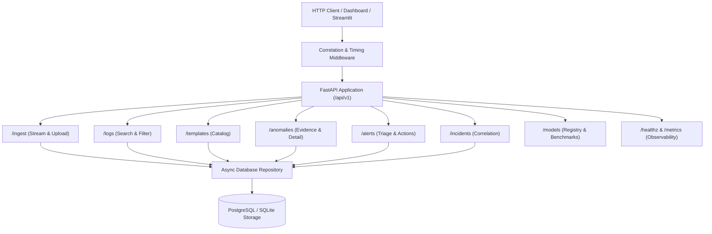

# Stage 10 Completion Report: Backend API & Database Engineering

**Stage:** STAGE 10 — Backend API & Database Engineering  
**Date:** 2026-11-03  
**Status:** COMPLETED (Passed Acceptance Gate)  

---

## 1. Objectives Completed
- [x] Implemented Async Database Models (`src/database/models.py`) with SQLAlchemy 2.0 ORM:
  - `IngestionJobORM`: Ingestion batch telemetry, throughput, duration, record validation counts.
  - `LogTemplateORM`: Mined template catalog, parameter samples, first/last seen timestamps.
  - `LogEventORM`: High-throughput structured log records with composite index `(timestamp, service)`.
  - `AnomalyORM`: Detected anomaly records with multi-factor risk scores and algorithms.
  - `AnomalyEvidenceORM`: Granular supporting log evidence items linking anomalies to raw trigger logs.
  - `AlertORM`: Triage alerts with deduplication keys, cooldown counters, and resolution notes.
  - `IncidentORM`: Correlated spatio-temporal cluster incidents.
  - `AuditLogORM`: Immutable governance audit trail with entity type, action, actor, and metadata.
- [x] Implemented Asynchronous Connection & Session Lifecycle (`src/database/connection.py`):
  - Async sessionmaker with `get_db_session` dependency for FastAPI.
  - Dual support for production PostgreSQL (`asyncpg`) and zero-configuration local SQLite (`aiosqlite`).
  - Lifespan initialization hooks `init_db()` and graceful disposal `close_db()`.
- [x] Implemented Asynchronous Database Repository (`src/database/repository.py`):
  - Paginated queries with multi-criteria filtering for logs, templates, anomalies, alerts, and incidents.
  - Safe transactions and audit log tracking for all state mutations.
- [x] Implemented REST API Endpoints under `/api/v1` (`src/api/routes/`):
  - `POST /api/v1/ingest/stream`: Synchronous/stream ingestion processing logs through Drain3, feature pipeline, anomaly assessment, alert manager, and incident correlator.
  - `POST /api/v1/ingest/upload`: Multipart log file upload for asynchronous batch processing.
  - `GET /api/v1/ingest/jobs/{job_id}`: Job execution telemetry and progress reporting.
  - `GET /api/v1/logs`: Search logs with service, host, severity, and template_id filters.
  - `GET /api/v1/templates`: Log template catalog ordered by frequency.
  - `GET /api/v1/anomalies`: Anomaly search with severity and service filtering.
  - `GET /api/v1/anomalies/{id}`: Detailed anomaly explanation with supporting evidence items.
  - `GET /api/v1/alerts`: Filter operational alerts by status and severity.
  - `POST /api/v1/alerts/{id}/action`: Operational triage (Acknowledge, Investigate, Resolve, False Positive).
  - `GET /api/v1/incidents`: Correlated operational incidents list and details.
  - `POST /api/v1/incidents/{id}/action`: Incident status modification and findings summary update.
  - `GET /api/v1/models`: Registry of 5 anomaly detectors (Modified Z, Isolation Forest, DeepLog, Autoencoder, Hybrid).
  - `GET /api/v1/models/benchmark`: Rigorous benchmark evaluation metrics on HDFS Loghub.
- [x] Observability, Middleware, and Health Probes (`src/api/main.py`, `src/api/middleware.py`):
  - `CorrelationAndTimingMiddleware`: Injects `X-Correlation-ID` and `X-Response-Time-Ms` headers.
  - `/healthz`: Dynamic database connectivity probe and service status.
  - `/metrics`: Prometheus telemetry scrape endpoint.
- [x] Automated Integration Test Suite (`tests/integration/test_api.py`):
  - 11 comprehensive tests validating all routes, error handling (404/400), and state persistence.
- [x] All 63 project tests pass with 100% success rate.

---

## 2. API Architecture & Routing Map

---

## 3. Files Created or Modified
- `src/database/models.py`
- `src/database/connection.py`
- `src/database/repository.py`
- `src/database/__init__.py`
- `src/api/schemas.py`
- `src/api/middleware.py`
- `src/api/routes/ingest.py`
- `src/api/routes/logs.py`
- `src/api/routes/templates.py`
- `src/api/routes/anomalies.py`
- `src/api/routes/alerts.py`
- `src/api/routes/incidents.py`
- `src/api/routes/models.py`
- `src/api/routes/__init__.py`
- `src/api/main.py`
- `src/api/__init__.py`
- `tests/integration/test_api.py`
- `docs/reports/stage_10_completion_report.md`

---

## 4. Test Verification Summary
- **Test Command:** `python -m pytest tests/ -v`
- **Total Tests Collected:** 63
- **Passed:** 63
- **Failed:** 0
- **Duration:** 40.79s
