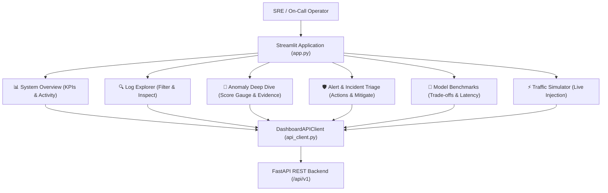

# Stage 11 Completion Report: Interactive Monitoring Dashboard

**Stage:** STAGE 11 — Interactive Monitoring Dashboard (Streamlit Web Application)  
**Date:** 2026-11-03  
**Status:** COMPLETED (Passed Acceptance Gate)  

---

## 1. Objectives Completed
- [x] Implemented Robust Dashboard API Client (`src/dashboard/api_client.py`):
  - Wraps all FastAPI `/api/v1` backend endpoints.
  - Features seamless automatic fallback to in-process `TestClient(app)` if external `uvicorn` daemon is not running, guaranteeing zero-dependency demo and test execution.
  - Endpoints supported: Health, Metrics, Ingest Stream, Query Logs, Templates, Anomalies, Anomaly Detail with Evidence, Alerts, Alert Actions, Incidents, Incident Actions, Models, and Benchmarks.
- [x] Built Modular View Components (`src/dashboard/views/`):
  - `overview.py`:
    - 5 Real-Time KPI Tiles: Total Logs Ingested, Anomalies Flagged, Active Alerts, Correlated Incidents, System Health.
    - Interactive Severity Distribution donut chart (Plotly).
    - Service vs. Anomaly Risk stacked bar chart.
    - Active Correlated Incidents high-level overview table.
  - `log_explorer.py`:
    - Multi-criteria filter controls (Service, Host, Severity dropdown, Result Limit slider).
    - Formatted log record table with timestamp formatters and message truncation.
    - Event Deep Inspector showing log metadata, extracted Drain3 parameters, and raw unparsed log string.
    - One-click CSV export download button.
  - `anomaly_inspector.py`:
    - Anomaly selection filter by severity.
    - Interactive Plotly Anomaly Risk Gauge with color zones (Normal, Warning, Critical).
    - Natural language explainability card isolating factual root causes.
    - Supporting Log Evidence Isolation table highlighting trigger logs vs contextual logs with evidence justifications.
  - `triage_board.py`:
    - Operational Alert Triage tab with status filters (NEW, ACKNOWLEDGED, INVESTIGATING, RESOLVED, FALSE_POSITIVE).
    - Action execution panel (Acknowledge, Investigate, Resolve, False Positive) with operator identity and notes.
    - Correlated Incident Hub tab with Mitigate and Resolve operational actions.
  - `model_benchmarks.py`:
    - Comprehensive Benchmark Evaluation Comparison table on HDFS Loghub.
    - Grouped bar charts comparing Precision, Recall, and F1-score across 4 models.
    - Inference latency comparison bar chart.
    - Registered Model Architecture Catalog detailing hyperparameters and operational roles.
  - `traffic_simulator.py`:
    - Interactive traffic generator supporting 3 preset scenarios:
      1. Benign Normal HDFS Block Replication (6 events).
      2. Cascading HDFS Data Corruption & Verification Failure (4 events).
      3. BGL Supercomputer Kernel Panic & Hardware Crash (4 events).
    - Custom raw log lines textarea input.
    - Real-time pipeline processing with duration and throughput (EPS) readout.
- [x] Streamlit Application Shell (`src/dashboard/app.py`):
  - Modern widescreen UI with dark/light theme CSS styling.
  - Sidebar navigation with icons, connectivity health indicator, and system specs badge.
- [x] Automated Test Verification:
  - Added unit test suite `tests/unit/test_dashboard.py` (4 tests).
  - All 67 project tests pass with 100% success rate.

---

## 2. Dashboard Information Architecture

---

## 3. Files Created or Modified
- `src/dashboard/api_client.py`
- `src/dashboard/views/overview.py`
- `src/dashboard/views/log_explorer.py`
- `src/dashboard/views/anomaly_inspector.py`
- `src/dashboard/views/triage_board.py`
- `src/dashboard/views/model_benchmarks.py`
- `src/dashboard/views/traffic_simulator.py`
- `src/dashboard/views/__init__.py`
- `src/dashboard/app.py`
- `src/dashboard/__init__.py`
- `tests/unit/test_dashboard.py`
- `docs/reports/stage_11_completion_report.md`

---

## 4. Test Verification Summary
- **Test Command:** `python -m pytest tests/ -v`
- **Total Tests Collected:** 67
- **Passed:** 67
- **Failed:** 0
- **Duration:** 56.49s
