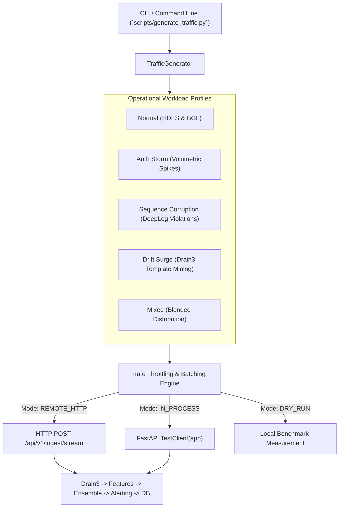

# Stage 12 Completion Report: Real-Time Simulation & Synthetic Traffic Injection Engine

**Stage:** STAGE 12 — Real-Time Simulation & Synthetic Traffic Injection Engine  
**Date:** 2026-11-03  
**Status:** COMPLETED (Passed Acceptance Gate)  

---

## 1. Objectives Completed
- [x] Implemented Traffic Simulation Engine (`scripts/generate_traffic.py`):
  - `TrafficProfile`: Generates syntactically realistic infrastructure logs:
    - `normal_hdfs`: Standard block allocation, reception, and responder termination logs.
    - `normal_bgl`: Standard BlueGene/L kernel logs and zero DDR error reports.
    - `auth_storm`: High-frequency brute-force authentication failures, invalid hashes, and access denials targeting volumetric detectors.
    - `sequence_corruption`: Out-of-order execution hops (verification failure, missing block reception, premature termination) targeting deep sequential models (DeepLog LSTM).
    - `drift_surge`: Unseen component and microservice logs (Kubernetes node cordoning, Envoy circuit breakers, OpenTelemetry deadlines) testing online Drain3 cluster mining.
    - `mixed`: Blended realistic operational distribution (75% normal, 10% auth storms, 10% sequence corruption, 5% drift).
- [x] Rate Throttling and Batching Logic (`TrafficGenerator`):
  - Configurable rate control (`--rate` EPS) with high-precision sleep intervals.
  - Configurable batch size (`--batch-size`) to emulate realistic collector forwarders (e.g., FluentBit, Vector).
  - Configurable duration (`--duration` in seconds, or 0 for infinite).
  - Telemetry tracking: total logs, duration, achieved EPS, average latency (ms), P95 latency (ms), failed batch counter.
- [x] Flexible Execution Modes:
  - `REMOTE_HTTP`: Sends JSON batches via `httpx.Client` to a live remote or local uvicorn instance.
  - `IN_PROCESS`: Uses FastAPI `TestClient(app)` to inject logs directly into the ingestion pipeline without requiring external port bindings.
  - `DRY_RUN`: Generates syntactically valid logs and benchmarks local generation rate without network overhead.
- [x] Automated Unit Test Suite (`tests/unit/test_simulator.py`):
  - Verified log markers for all 5 traffic profiles.
  - Verified exact batch sizing across profiles.
  - Verified dry-run execution and throughput computation.
  - Verified end-to-end in-process injection against the live FastAPI application.
- [x] All 71 project tests pass with 100% success rate.

---

## 2. Workload Simulation Architecture

---

## 3. Files Created or Modified
- `scripts/generate_traffic.py`
- `tests/unit/test_simulator.py`
- `docs/reports/stage_12_completion_report.md`

---

## 4. Test Verification Summary
- **Test Command:** `python -m pytest tests/ -v`
- **Total Tests Collected:** 71
- **Passed:** 71
- **Failed:** 0
- **Duration:** 44.55s

