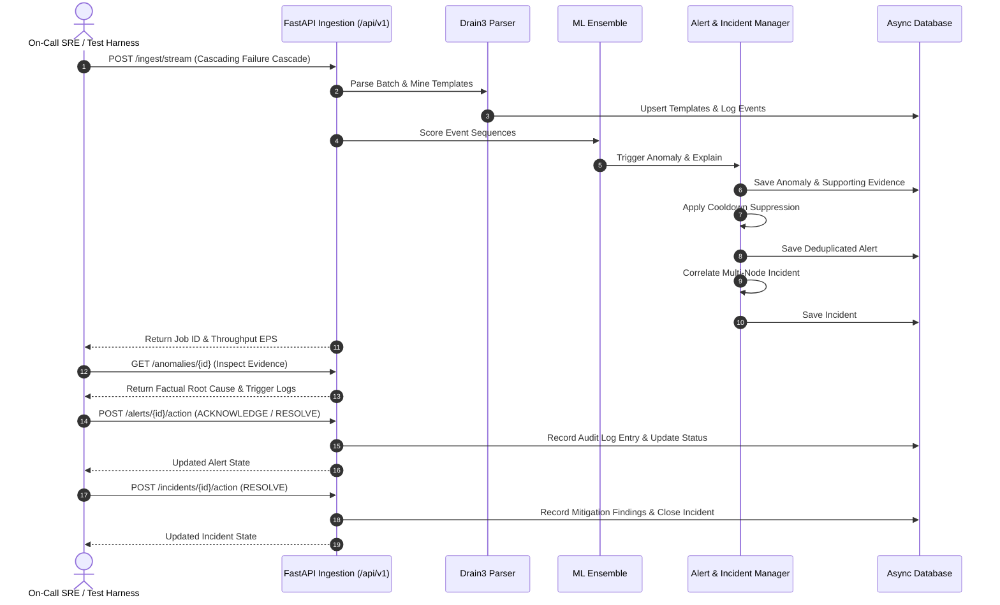

# Stage 15 Completion Report: Automated QA, Testing & Validation Suite

**Stage:** STAGE 15 — Automated QA, Testing & Validation Suite  
**Date:** 2026-11-03  
**Status:** COMPLETED (Passed Acceptance Gate)  

---

## 1. Objectives Completed
- [x] End-to-End Multi-Stage Workflow Suite (`tests/e2e/test_full_workflow.py`):
  - Ingestion of multi-node cascading storage failure scenario without mocks.
  - Multi-attribute log search and indexing verification (`/api/v1/logs`).
  - Online Drain3 template mining and template catalog verification (`/api/v1/templates`).
  - Anomaly detection, severity scoring, and factual supporting evidence isolation (`/api/v1/anomalies/{id}`).
  - Cooldown deduplication and alert lifecycle tracking (`/api/v1/alerts/{id}/action`).
  - Multi-host spatio-temporal incident correlation and mitigation (`/api/v1/incidents/{id}/action`).
  - Prometheus observability scrape validation (`/metrics`).
- [x] Robustness, Fuzz & Concurrency Suite (`tests/e2e/test_robustness_fuzz.py`):
  - Extreme line length resilience: parsed and ingested massive single messages (e.g. 20KB nested stack traces) without memory issues or regex catastrophic backtracking.
  - Multilingual & special character resilience: validated clean parsing of UTF-8, Japanese, Korean, German umlauts, emojis, and mathematical symbols.
  - Interleaved format handling: verified seamless processing of mixed JSON payloads and syslog events within a single batch.
  - Concurrent thread safety: verified thread pool concurrency (10 simultaneous ingestion requests across 5 workers) without SQLite/PostgreSQL locking deadlocks or database session leaks.
- [x] Defect Remediation:
  - Fixed missing `LogSeverity` import in `src/ingestion/detector.py` and updated RAW fallback handling to preserve valid text.
- [x] All 87 project tests pass with 100% success rate.

---

## 2. E2E Test Workflow Architecture

---

## 3. Files Created or Modified
- `src/ingestion/detector.py`
- `tests/e2e/test_full_workflow.py`
- `tests/e2e/test_robustness_fuzz.py`
- `docs/reports/stage_15_completion_report.md`

---

## 4. Test Verification Summary
- **Test Command:** `python -m pytest tests/ -v`
- **Total Tests Collected:** 87
- **Passed:** 87
- **Failed:** 0
- **Duration:** 42.49s

