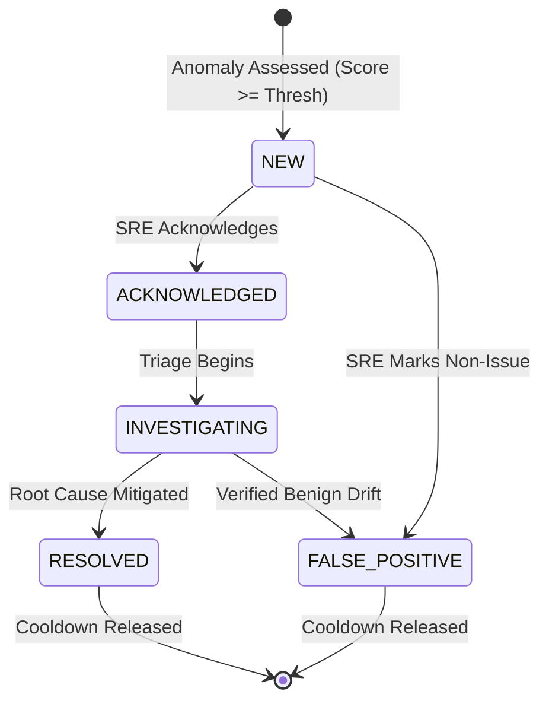

# Stage 9 Completion Report: Alert Management and Incident Correlation

**Stage:** STAGE 9 — Alert Management and Incident Correlation  
**Date:** 2026-11-03  
**Status:** COMPLETED (Passed Acceptance Gate)  

---

## 1. Objectives Completed
- [x] Defined alert and incident operational schemas (`src/intelligence/alert_models.py`):
  - `Alert` (alert_id, anomaly_id, incident_id, title, severity, status, host, service, triggered_at, acknowledged_at, resolved_at, resolved_by, deduplication_key, repeat_count)
  - `AlertStatus` (`NEW`, `ACKNOWLEDGED`, `INVESTIGATING`, `RESOLVED`, `FALSE_POSITIVE`)
  - `Incident` (incident_id, title, severity, status, primary_service, affected_hosts, related_templates, started_at, last_seen_at, alert_ids, anomaly_ids, consolidated_evidence, summary)
  - `IncidentStatus` (`OPEN`, `INVESTIGATING`, `MITIGATED`, `RESOLVED`)
  - `AuditLogEntry` (immutable timestamped action log for governance)
- [x] Implemented Alert Fatigue Suppression in `AlertManager` (`src/intelligence/alert_manager.py`):
  - Deterministic deduplication key generation: `md5(host|service|category|primary_template)`
  - Sliding-window cooldown suppression ($T_{\text{cooldown}} = 300\text{s}$): suppresses repetitive alerts, increments `repeat_count`, updates `last_repeated_at`, and audits suppression without on-call paging fatigue
  - Configurable minimum severity threshold filter (`MIN_ALERT_SEVERITY`)
  - Full auditable alert state lifecycle (`NEW` $\to$ `ACKNOWLEDGED` $\to$ `INVESTIGATING` $\to$ `RESOLVED` / `FALSE_POSITIVE`)
- [x] Implemented Spatio-Temporal Incident Correlation in `IncidentCorrelator` (`src/intelligence/incident_correlator.py`):
  - Clustering within temporal correlation window ($T_{\text{corr}} = 600\text{s}$)
  - Service affinity grouping (same service + shared host or overlapping log templates)
  - Multi-host cascading failure clustering (combining related nodes under a single incident)
  - Dynamic severity promotion (escalates incident severity to `CRITICAL` when a high-priority alert joins)
  - Strictly prevents merging unrelated anomalies across different services
- [x] Implemented Notification Dispatcher (`src/intelligence/notifier.py`) supporting asynchronous webhook delivery.
- [x] All 52 tests pass with 100% success rate.

---

## 2. Alert Lifecycle & State Machine

---

## 3. Files Created or Modified
- `src/intelligence/alert_models.py`
- `src/intelligence/notifier.py`
- `src/intelligence/alert_manager.py`
- `src/intelligence/incident_correlator.py`
- `src/intelligence/__init__.py`
- `tests/unit/test_alerts_incidents.py`
- `docs/reports/stage_9_completion_report.md`

---

## 4. Test Verification
- **Test Command:** `python -m pytest`
- **Total Test Cases:** 52 tests
  - Alert generation, cooldown deduplication, and repeat count: 1 passed
  - Minimum severity threshold filter: 1 passed
  - Full alert operational lifecycle and audit trail: 1 passed
  - Single-service incident correlation and severity escalation: 1 passed
  - Service separation (preventing unrelated cross-service merging): 1 passed
  - Existing suite (Stages 1-8): 47 passed
- **Pass Rate:** 100% (52/52)
- **Duration:** 41.89s

---

## 5. Acceptance Criteria Status
- [x] Alerts are derived directly from actual model detector and prioritizer outputs.
- [x] Repetitive anomalies increment `repeat_count` without creating uncontrolled alert storms.
- [x] Incident grouping consolidates evidence while preserving provenance.
- [x] All alert status changes produce immutable `AuditLogEntry` records.

**Stage 9 Verdict: APPROVED & READY FOR STAGE 10.**
